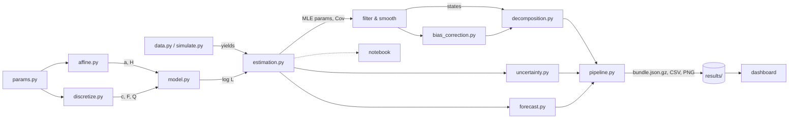

# Architecture

## Repository layout

```
vasicek_3f/
├── src/vasicek3f/              the model — all logic lives here
│   ├── params.py               identification scheme, parameter container, unconstrained transforms
│   ├── affine.py               bond pricing: closed-form Q loadings, ODE solver for P, EH reference
│   ├── discretize.py           exact OU discretisation (Van Loan) and its inverse
│   ├── kalman.py               Kalman filter (missing data), collapsed fast likelihood, RTS smoother
│   ├── model.py                state-space model from parameters; log-likelihood; filter + smoother
│   ├── estimation.py           two-stage starting values, MLE, numerical-Hessian standard errors
│   ├── decomposition.py        term premium decomposition and loadings tables
│   ├── bias_correction.py      bootstrap small-sample bias correction of the P dynamics
│   ├── uncertainty.py          parameter-uncertainty bands for the term premium
│   ├── forecast.py             yield forecasts and expanding-window out-of-sample evaluation
│   ├── diagnostics.py          pricing errors, PCA, factor correlations, benchmark comparison
│   ├── data.py                 GSW / ACM / Kim-Wright loaders and downloader
│   ├── simulate.py             realistic true parameters and panel simulator
│   ├── serialization.py        version-independent results bundles (gzipped JSON)
│   ├── plotting.py             static matplotlib figures
│   ├── pipeline.py             end-to-end run, results bundle, summary report
│   └── cli.py, __main__.py     `vasicek3f download | run`
├── dashboard/
│   ├── app.py                  layout, sidebar, navigation
│   ├── context.py              bundle loading and the per-request context object
│   ├── theme.py                palette, Plotly template, CSS, chart helpers
│   └── views/                  one module per tab
├── streamlit_app.py            entry point for Streamlit Cloud
├── notebooks/                  walkthrough notebook and its builder script
├── tests/                      unit, recovery, pipeline and data-loader tests
├── docs/                       this documentation (MkDocs)
├── scripts/build_wiki.py       generates the GitHub wiki pages from docs/
├── results/                    published runs (bundle + CSV + figures + summary)
└── data/                       local data files (not versioned)
```

## Data flow



## Design principles

- **One source of truth.** The CLI, notebook, tests and dashboard import the package; none re-implements pricing or estimation.
- **`pipeline.py` is the hand-off point.** It runs everything once and writes a results bundle. The dashboard reads bundles (instant) and only adds sensitivity shocks, which reuse the package's pricing and filtering functions.
- **Portable outputs.** Bundles are gzipped JSON with explicit encodings, so a run saved locally loads on any deployment regardless of pandas/numpy versions.
- **Exactness over approximation.** Exact discretisation, exact likelihood, closed-form Q loadings; numerical shortcuts (collapsed filter, steady-state gain) are exact and tested against the plain versions.
- **Units.** Decimals and annualised time internally; percent and basis points only for display and CSV exports (`*_pct.csv`, `*_bp.csv`).
