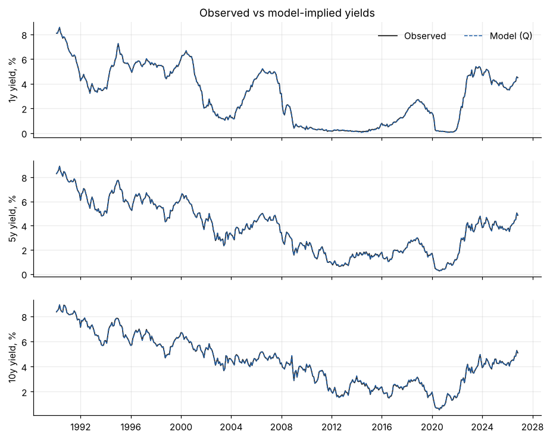
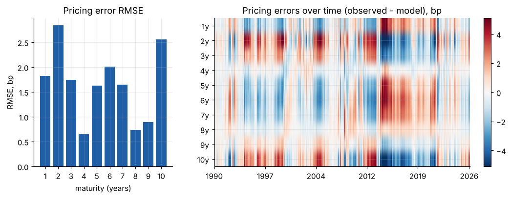
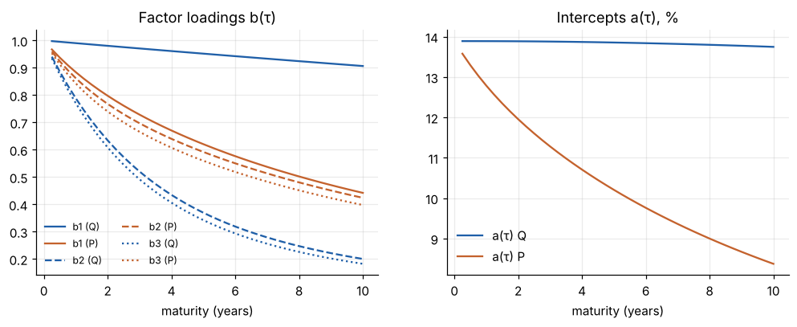
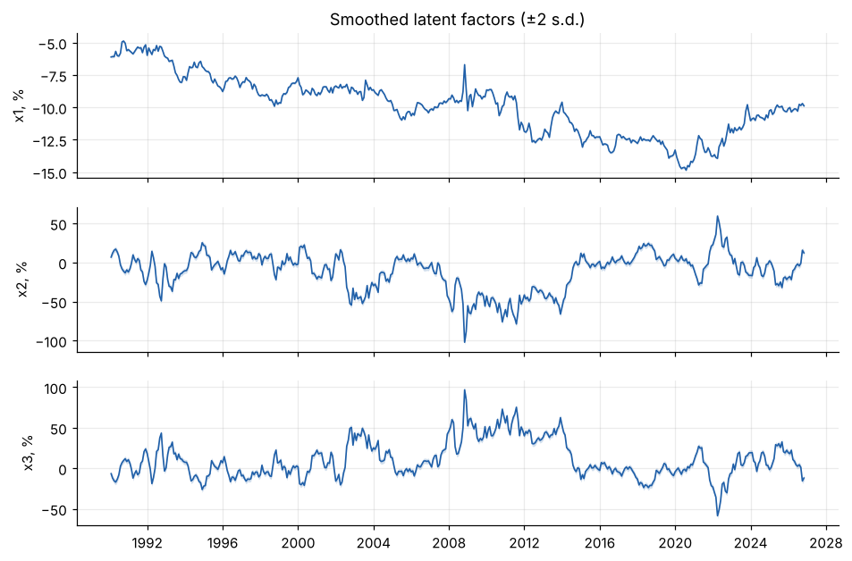
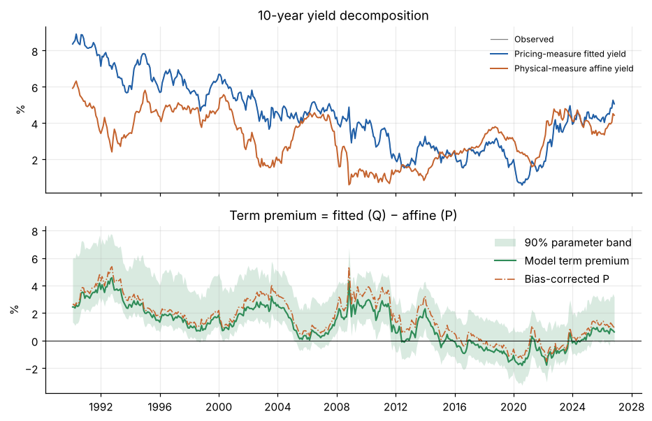
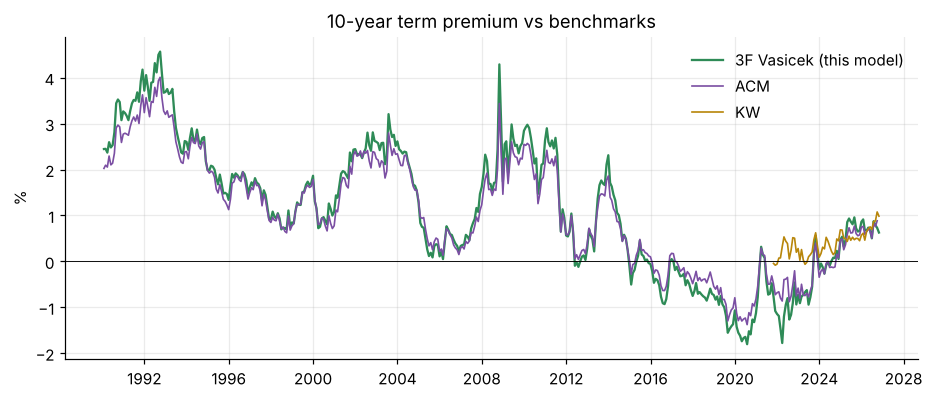
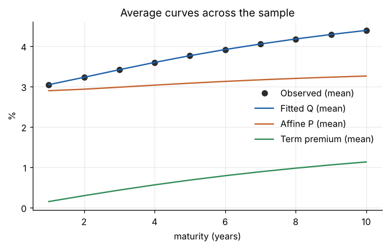

# 3-Factor Vasicek term structure model: results

Source: **gsw**, 442 months, 1990-01 to 2026-10, maturities 1y, 2y, 3y, 4y, 5y, 6y, 7y, 8y, 9y, 10y. Runtime 335s.

## Estimation

- Log-likelihood: 27,897.12  (AIC -55,748.2, BIC -55,601.2, 23 parameters, 4420 observations)
- Optimiser: CONVERGENCE: RELATIVE REDUCTION OF F <= FACTR*EPSMCH after 896 iterations
- kappa_Q: [0.02, 0.4965, 0.5467]  (Q half-lives, years: [34.65, 1.4, 1.27])
- eigenvalues of K_P (real part): [1.0211, 0.1655, 0.2876]  (P half-lives, years: [0.68, 4.19, 2.41])
- Long-run short rate: Q 13.89%, P 4.15%
- Measurement error s.d. (bp): [2.12, 2.12, 2.12, 2.12, 2.12, 2.12, 2.12, 2.12, 2.12, 2.12]

## Fit

PCA of yield levels (share of variance): PC1 96.48%, PC2 3.41%, PC3 0.11%, PC4 0.01%, PC5 0.00%

|   maturity |   mean_bp |   mae_bp |   rmse_bp |   max_abs_bp |   ar1 |
|-----------:|----------:|---------:|----------:|-------------:|------:|
|          1 |     -0.09 |     1.46 |      1.82 |         5.27 |  0.82 |
|          2 |      0.2  |     2.26 |      2.85 |         9.04 |  0.84 |
|          3 |      0.02 |     1.43 |      1.74 |         4.64 |  0.83 |
|          4 |     -0.14 |     0.46 |      0.65 |         3.48 |  0.5  |
|          5 |     -0.15 |     1.29 |      1.63 |         5.04 |  0.82 |
|          6 |     -0.03 |     1.63 |      2.01 |         5.71 |  0.86 |
|          7 |      0.1  |     1.36 |      1.65 |         4.2  |  0.86 |
|          8 |      0.16 |     0.59 |      0.73 |         4.17 |  0.81 |
|          9 |      0.09 |     0.71 |      0.9  |         2.69 |  0.79 |
|         10 |     -0.17 |     2.11 |      2.56 |         6.95 |  0.87 |

## Term premium

10y term premium: mean 1.13%, s.d. 1.42%, min -1.80%, max 4.57%, latest 0.63% (2026-10).

Decomposition: **Term Premium = Pricing-Measure Fitted Yield − Physical-Measure Affine Yield**. The P-affine yield is a no-risk-premium benchmark inside the model, not a strict Expectations-Hypothesis average of expected short rates.

**Bias-corrected P dynamics** (Kilian bootstrap, 500 draws; 100% of the estimated bias removed): 10y term premium mean 1.65%, latest 0.96%. Largest VAR root 0.9782 -> 0.9907; P half-lives (years) [0.73, 6.18, 6.18].

**Parameter-uncertainty band** (90%, 186 draws): average width 350bp; latest -0.20% to 3.18%.

### Out-of-sample forecasts vs random walk

Expanding window from month 221, refit every 12 months. Ratio < 1 and negative DM favour the model.

|   horizon_m |   maturity |   n |   rmse_model_bp |   rmse_rw_bp |   ratio |   dm_stat |
|------------:|-----------:|----:|----------------:|-------------:|--------:|----------:|
|           1 |          1 | 221 |          18.213 |       18.495 |   0.985 |    -0.426 |
|           1 |          2 | 221 |          22.213 |       21.338 |   1.041 |     1.601 |
|           1 |          3 | 221 |          23.552 |       22.874 |   1.03  |     1.757 |
|           1 |          4 | 221 |          24.3   |       23.938 |   1.015 |     1.259 |
|           1 |          5 | 221 |          24.908 |       24.768 |   1.006 |     0.519 |
|           1 |          6 | 221 |          25.434 |       25.455 |   0.999 |    -0.076 |
|           1 |          7 | 221 |          25.939 |       26.019 |   0.997 |    -0.269 |
|           1 |          8 | 221 |          26.508 |       26.452 |   1.002 |     0.172 |
|           1 |          9 | 221 |          27.225 |       26.753 |   1.018 |     1.222 |
|           1 |         10 | 221 |          28.157 |       26.924 |   1.046 |     2.52  |
|           6 |          1 | 216 |          68.269 |       68.79  |   0.992 |    -0.08  |
|           6 |          2 | 216 |          68.829 |       66.54  |   1.034 |     0.49  |
|           6 |          3 | 216 |          68.42  |       65.363 |   1.047 |     0.806 |
|           6 |          4 | 216 |          67.71  |       64.694 |   1.047 |     0.902 |
|           6 |          5 | 216 |          67.001 |       64.317 |   1.042 |     0.845 |
|           6 |          6 | 216 |          66.482 |       64.1   |   1.037 |     0.749 |
|           6 |          7 | 216 |          66.254 |       63.945 |   1.036 |     0.704 |
|           6 |          8 | 216 |          66.353 |       63.782 |   1.04  |     0.747 |
|           6 |          9 | 216 |          66.778 |       63.573 |   1.05  |     0.877 |
|           6 |         10 | 216 |          67.508 |       63.31  |   1.066 |     1.074 |
|          12 |          1 | 210 |         112.265 |      115.867 |   0.969 |    -0.274 |
|          12 |          2 | 210 |         108.329 |      106.221 |   1.02  |     0.2   |
|          12 |          3 | 210 |         104.126 |       99.211 |   1.05  |     0.534 |
|          12 |          4 | 210 |         100.468 |       94.454 |   1.064 |     0.708 |
|          12 |          5 | 210 |          97.6   |       91.401 |   1.068 |     0.754 |
|          12 |          6 | 210 |          95.579 |       89.509 |   1.068 |     0.736 |
|          12 |          7 | 210 |          94.348 |       88.311 |   1.068 |     0.715 |
|          12 |          8 | 210 |          93.802 |       87.473 |   1.072 |     0.724 |
|          12 |          9 | 210 |          93.822 |       86.783 |   1.081 |     0.773 |
|          12 |         10 | 210 |          94.297 |       86.129 |   1.095 |     0.859 |

### Benchmark comparison

|     |   n_months | start      | end        |   corr_level |   corr_12m_change |   mean_model_pct |   mean_bench_pct |   mean_diff_bp |   rmse_diff_bp |
|:----|-----------:|:-----------|:-----------|-------------:|------------------:|-----------------:|-----------------:|---------------:|---------------:|
| ACM |        441 | 1990-01-31 | 2026-09-30 |        0.995 |             0.974 |            1.132 |            1.058 |          7.439 |         26.552 |
| KW  |         61 | 2021-10-31 | 2026-10-31 |        0.708 |            -0.053 |           -0.080 |            0.389 |        -46.947 |         76.195 |

## Figures

