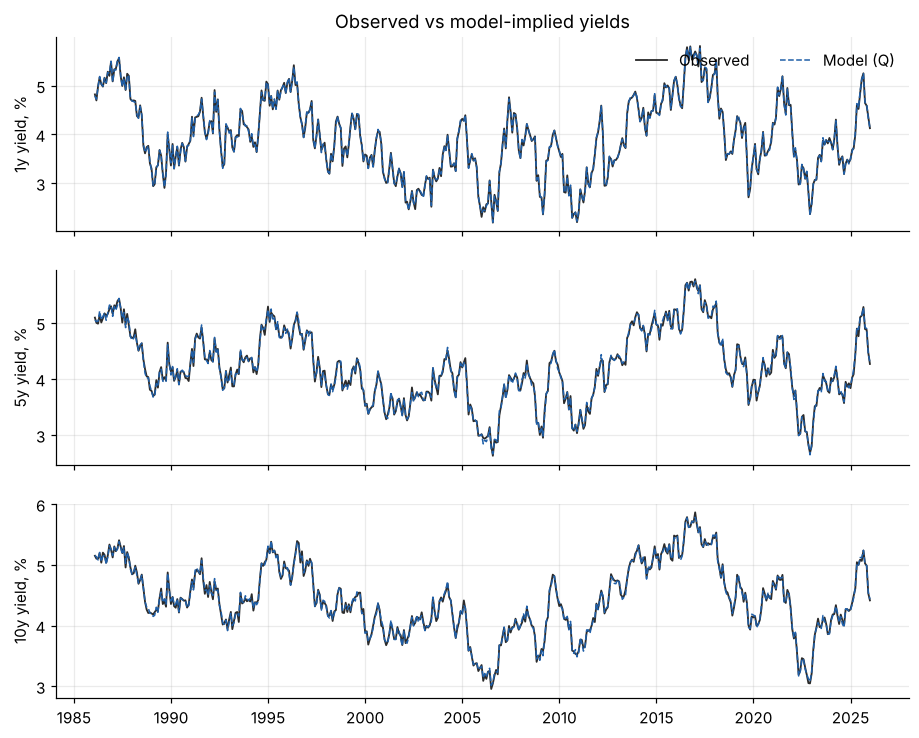
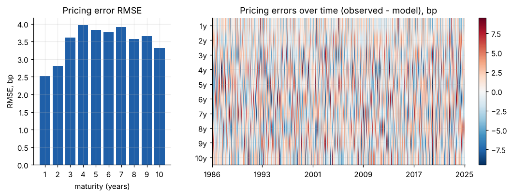
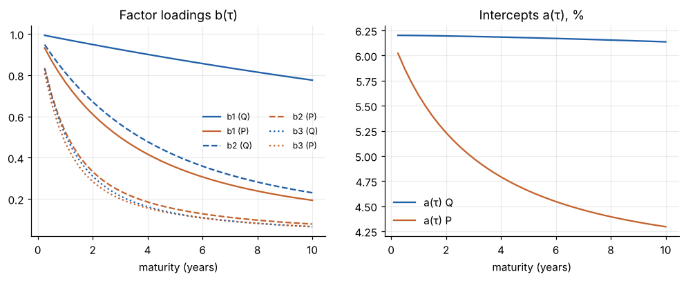
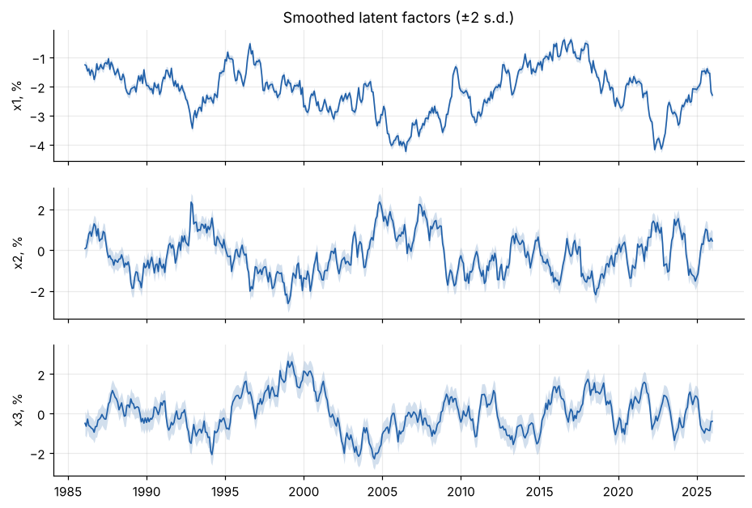
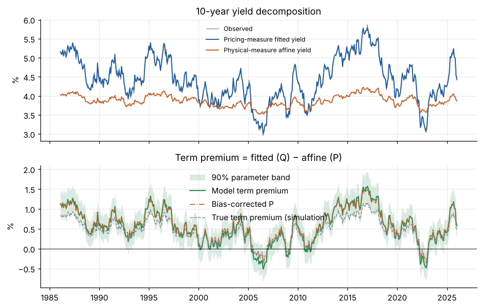
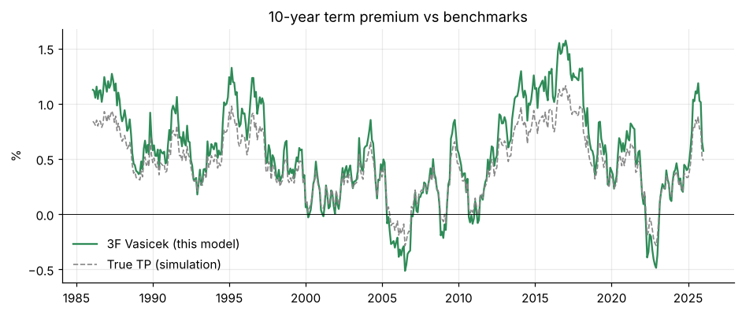
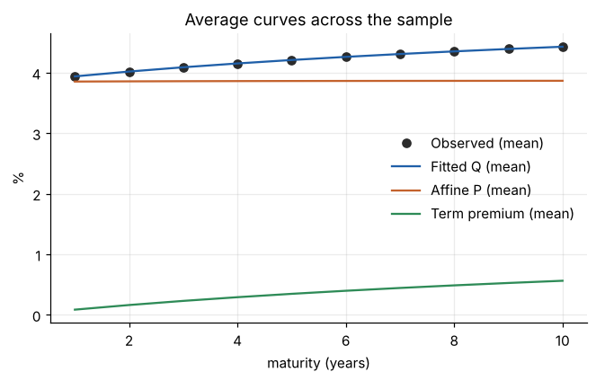

# 3-Factor Vasicek term structure model: results

Source: **simulated**, 480 months, 1986-01 to 2025-12, maturities 1y, 2y, 3y, 4y, 5y, 6y, 7y, 8y, 9y, 10y. Runtime 113s.

## Estimation

- Log-likelihood: 28,455.51  (AIC -56,847.0, BIC -56,639.8, 32 parameters, 4800 observations)
- Optimiser: CONVERGENCE: RELATIVE REDUCTION OF F <= FACTR*EPSMCH after 129 iterations
- kappa_Q: [0.0531, 0.4294, 1.5393]  (Q half-lives, years: [13.05, 1.61, 0.45])
- eigenvalues of K_P (real part): [0.4748, 1.4968, 1.4968]  (P half-lives, years: [1.46, 0.46, 0.46])
- Long-run short rate: Q 6.20%, P 3.88%
- Measurement error s.d. (bp): [4.39, 3.5, 4.07, 4.29, 4.1, 4.02, 4.19, 3.94, 4.07, 3.82]

## Fit

PCA of yield levels (share of variance): PC1 96.29%, PC2 3.14%, PC3 0.30%, PC4 0.04%, PC5 0.04%

|   maturity |   mean_bp |   mae_bp |   rmse_bp |   max_abs_bp |   ar1 |
|-----------:|----------:|---------:|----------:|-------------:|------:|
|          1 |     -0.06 |     2.02 |      2.51 |         9.16 | -0.31 |
|          2 |      0.17 |     2.26 |      2.8  |         7.7  | -0.07 |
|          3 |     -0.25 |     2.82 |      3.61 |        11.36 | -0.07 |
|          4 |     -0.08 |     3.14 |      3.97 |        12.97 | -0    |
|          5 |      0.11 |     2.99 |      3.83 |        14.92 | -0.03 |
|          6 |      0.09 |     3.06 |      3.76 |        10.92 | -0.04 |
|          7 |     -0.02 |     3.13 |      3.91 |        13.42 | -0.01 |
|          8 |     -0.03 |     2.9  |      3.58 |         9.57 |  0.02 |
|          9 |      0    |     2.89 |      3.66 |        11.54 | -0.07 |
|         10 |     -0.01 |     2.65 |      3.31 |         9.95 | -0.1  |

## Term premium

10y term premium: mean 0.56%, s.d. 0.43%, min -0.51%, max 1.57%, latest 0.57% (2025-12).

Decomposition: **Term Premium = Pricing-Measure Fitted Yield − Physical-Measure Affine Yield**. The P-affine yield is a no-risk-premium benchmark inside the model, not a strict Expectations-Hypothesis average of expected short rates.

**Bias-corrected P dynamics** (Kilian bootstrap, 500 draws; 100% of the estimated bias removed): 10y term premium mean 0.59%, latest 0.61%. Largest VAR root 0.9604 -> 0.9711; P half-lives (years) [1.97, 0.52, 0.52].

**Parameter-uncertainty band** (90%, 199 draws): average width 67bp; latest 0.28% to 0.90%.

### Out-of-sample forecasts vs random walk

Expanding window from month 240, refit every 12 months. Ratio < 1 and negative DM favour the model.

|   horizon_m |   maturity |   n |   rmse_model_bp |   rmse_rw_bp |   ratio |   dm_stat |
|------------:|-----------:|----:|----------------:|-------------:|--------:|----------:|
|           1 |          1 | 240 |          30.441 |       31.744 |   0.959 |    -2.824 |
|           1 |          2 | 240 |          26.388 |       27.153 |   0.972 |    -2.092 |
|           1 |          3 | 240 |          23.497 |       24.277 |   0.968 |    -2.156 |
|           1 |          4 | 240 |          21.627 |       22.661 |   0.954 |    -3.124 |
|           1 |          5 | 240 |          20.252 |       20.978 |   0.965 |    -2.319 |
|           1 |          6 | 240 |          19.432 |       20.073 |   0.968 |    -1.974 |
|           1 |          7 | 240 |          19.018 |       19.739 |   0.963 |    -2.3   |
|           1 |          8 | 240 |          17.711 |       18.254 |   0.97  |    -2.152 |
|           1 |          9 | 240 |          17.852 |       18.458 |   0.967 |    -2.148 |
|           1 |         10 | 240 |          16.757 |       16.98  |   0.987 |    -0.773 |
|           6 |          1 | 235 |          63.757 |       73.872 |   0.863 |    -3.6   |
|           6 |          2 | 235 |          57.913 |       66.125 |   0.876 |    -3.344 |
|           6 |          3 | 235 |          53.063 |       59.812 |   0.887 |    -2.992 |
|           6 |          4 | 235 |          50.186 |       56.251 |   0.892 |    -2.93  |
|           6 |          5 | 235 |          47.989 |       53.386 |   0.899 |    -2.679 |
|           6 |          6 | 235 |          46.344 |       50.739 |   0.913 |    -2.307 |
|           6 |          7 | 235 |          44.936 |       48.988 |   0.917 |    -2.236 |
|           6 |          8 | 235 |          43.088 |       46.426 |   0.928 |    -2.044 |
|           6 |          9 | 235 |          42.279 |       45.371 |   0.932 |    -1.945 |
|           6 |         10 | 235 |          41.227 |       43.875 |   0.94  |    -1.59  |
|          12 |          1 | 229 |          75.07  |       94.457 |   0.795 |    -3.246 |
|          12 |          2 | 229 |          69.189 |       85.595 |   0.808 |    -3.248 |
|          12 |          3 | 229 |          64.868 |       79.114 |   0.82  |    -3.144 |
|          12 |          4 | 229 |          62.389 |       74.778 |   0.834 |    -2.958 |
|          12 |          5 | 229 |          59.999 |       71.147 |   0.843 |    -2.793 |
|          12 |          6 | 229 |          58.383 |       68.424 |   0.853 |    -2.633 |
|          12 |          7 | 229 |          56.787 |       66.082 |   0.859 |    -2.545 |
|          12 |          8 | 229 |          54.77  |       63.306 |   0.865 |    -2.438 |
|          12 |          9 | 229 |          54.009 |       61.94  |   0.872 |    -2.327 |
|          12 |         10 | 229 |          52.791 |       59.955 |   0.881 |    -2.095 |

### Benchmark comparison

|                      |   n_months | start      | end        |   corr_level |   corr_12m_change |   mean_model_pct |   mean_bench_pct |   mean_diff_bp |   rmse_diff_bp |
|:---------------------|-----------:|:-----------|:-----------|-------------:|------------------:|-----------------:|-----------------:|---------------:|---------------:|
| True TP (simulation) |        480 | 1986-01-31 | 2025-12-31 |        0.999 |             0.998 |            0.563 |            0.454 |         10.834 |         17.450 |

## Figures

